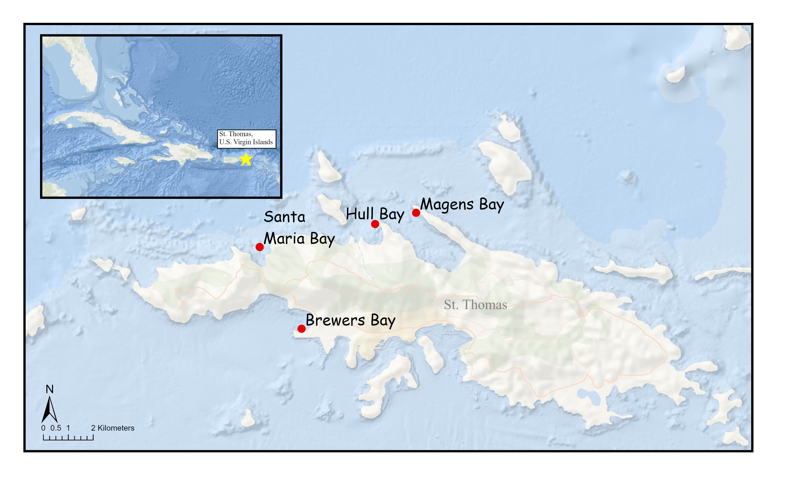
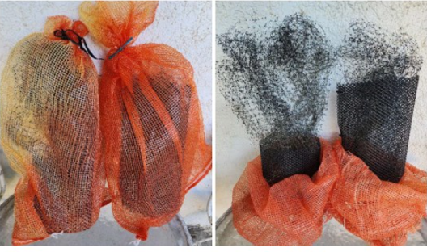
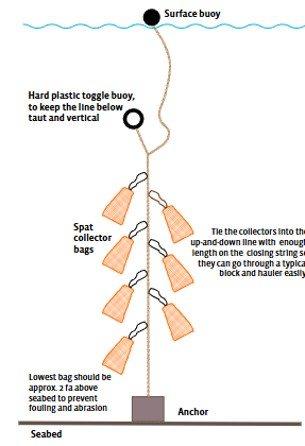

# Overview/Background

::: panel-tabset
## Overview

The USVI has an interest in researching and developing scallop aquaculture. Scallops are known to be present in waters across the territory, seen by divers at the bottom of the ocean, and shells washed onto shore. Scallop aquaculture methods can have low initial start-up costs, with no infrastructure required. Imported scallops are already being served at local restaurants and sold in island markets. The USVI would benefit from the implementation of sustainable scallop aquaculture, which would provide local and sustainable seafood options, create jobs, increase economic activity, and ultimately benefit the local communities (Turnbull et al., 2023).

## Background

Aquaculture includes raising, breeding, or harvesting marine organisms that provide food, improve economies, restore habitats, and replenish wild stocks. Nations around the world depend on aquaculture for sustainable seafood. Global aquaculture contributed 142 million tons of aquatic food and provided 23.1 million people with jobs in 2024. Aquaculture benefits become even more profound in smaller regions such as the United States Virgin Islands (USVI), which spends millions of dollars each year importing 97% of all its food. Sustainable aquaculture can increase food security in areas like the Caribbean, where 71.3% of the population suffered from moderate to severe hunger in 2020. The economy and environment in the USVI have the potential to benefit from bivalve aquaculture similar to the success seen in scallop aquaculture development in the United States northeastern coast. Using developed aquaculture methods, the USVI can develop a sustainable scallop aquaculture system that provides jobs to island locals, increases local seafood production, and improves coastal environmental conditions.
:::

# Thesis

::: panel-tabset
## Project

This study assesses the collection and growth parameters of scallop species in four bays around St. Thomas, USVI, by measuring water quality and scallop growth rates. Juvenile bivalves (spat) are collected from the ocean using mesh spat bags throughout a 60-foot water column. Spat are then identified by species, measured for size, and transferred into larger lantern nets for continued outgrowth. If scallop industry-standard aquaculture methods are used in St. Thomas, USVI, then multiple scallop species will be collected in abundance, with high growth rates reaching marketable size, indicating the feasibility of scallop aquaculture in the territory. The presence of scallop species, Nodipecten nodosus, Euvola ziczac, Argopecten gibbus, and Argopecten nucleus during spat collection will support the feasibility of scallop aquaculture on St. Thomas. This study will continue to provide scientific information on scallop species found in the USVI to improve marine conservation and support local communities.

## Site Map

:::

# Methods

::: panel-tabset
## Spat Collection

Spat bags will be used

## Outgrowing

Lantern nets will be used over longn period of time
:::

# Bio- About the Researcher

## Natalie Wride

Natalie is a second year Master Student working on her Masters of Science at the University of the Virgin Islands (UVI). She is currently a graduate teaching assistant at UVI and a marine vessel intern for Verimode LLC..

Natalie received her Bachelors of Science at Brigham Young University (BYU) with a major in biology and minors in environmental science and world dance. During her time at BYU she was able to participate in student research opportunities studying coral reefs in Moloka'i Hawaii and fish aquaponics in Ghana.

Natalie spent 2 years working at The Ohio State University's Stone Laboratory on Lake Erie as a biological field station assistant. Natalie assisted with freshwater research on fish, reptiles/amphibians, invertebrates, and water quality. She also was able to participate in outreach and teaching opportunities to all ages.

Natalie currently is enjoying her time living on St. Thomas, USVI, and excited to see what is next for her.
